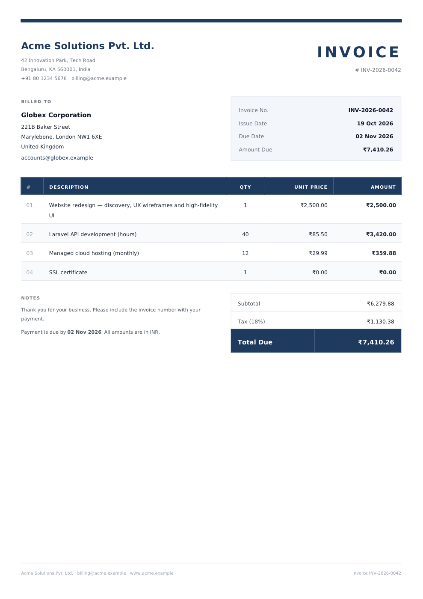
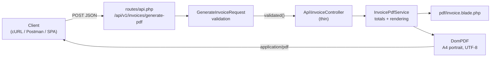

# Dynamic PDF Generation Engine — Invoices & Billing Reports

A modular Laravel 13 service that turns a JSON billing payload into a professional, print-ready **A4 invoice PDF**. It's built with a thin controller, a FormRequest for validation, a service layer for billing math and rendering, and a Blade template tuned for [DomPDF](https://github.com/barryvdh/laravel-dompdf).



> A full sample output is in [`docs/sample-invoice.pdf`](docs/sample-invoice.pdf).

---

## Features

- **Single endpoint, stateless:** `POST /api/v1/invoices/generate-pdf` returns the PDF as a file download. Nothing is persisted.
- **Strict validation.** A FormRequest validates every field, including each line item. Invalid input returns `422` with field-level JSON errors.
- **Exact money math.** Totals are computed in integer cents, so `0.1 + 0.2` is `0.30` and the printed line totals always add up to the printed subtotal. Tax is rounded half-up to the cent.
- **UTF-8 output.** Uses the bundled *DejaVu Sans* font (Latin, Greek, Cyrillic, and symbols such as `₹ € £`), with font subsetting to keep files small (~30 KB).
- **DomPDF-optimised template.** Table-based layout (DomPDF doesn't support flexbox or grid), embedded CSS, repeating table headers on page breaks, rows that never split across pages, and a fixed footer.
- **Abuse protection.** Per-IP rate limiting, plus caps on line-item count and description length, keep a public endpoint from tying up the server.
- **Deploy-ready.** A Dockerfile and Render blueprint deploy it to Render's free tier.
- **Configurable branding.** Company details, currency, payment terms, and footer note all come from `.env`.
- **Tested.** Unit tests cover the billing math. Feature tests cover the HTTP contract, validation, Unicode rendering, and filename sanitisation.

## Tech stack

PHP 8.3+ · Laravel 13 · `barryvdh/laravel-dompdf` ^3.1 · PHPUnit 12

---

## Architecture



| Layer | File | Responsibility |
| --- | --- | --- |
| Route | `routes/api.php` | Versioned API route (`/api/v1/...`) |
| Validation | `app/Http/Requests/GenerateInvoiceRequest.php` | Validates input shape and business constraints |
| Controller | `app/Http/Controllers/Api/InvoiceController.php` | Receives the service by constructor injection, delegates, and returns the download response |
| Service | `app/Services/InvoicePdfService.php` | Line totals, subtotal, tax, and grand total; builds view data; renders the PDF |
| View | `resources/views/pdf/invoice.blade.php` | Invoice layout with embedded CSS |
| Config | `config/invoice.php`, `config/dompdf.php` | Branding and billing defaults; DomPDF options |

### Project structure

```
app/
├── Http/
│   ├── Controllers/
│   │   └── Api/InvoiceController.php
│   └── Requests/
│       └── GenerateInvoiceRequest.php
├── Services/
│   └── InvoicePdfService.php
config/
├── dompdf.php
└── invoice.php
resources/
└── views/
    └── pdf/
        └── invoice.blade.php
routes/
└── api.php
tests/
├── Feature/GenerateInvoicePdfTest.php
└── Unit/InvoicePdfServiceTest.php
```

### Billing calculation

All amounts are converted to integer cents before any arithmetic:

```
line_total  = quantity × unit_price
subtotal    = Σ line_total
tax_amount  = round_half_up(subtotal × tax_percent / 100)
grand_total = subtotal + tax_amount
```

`tax_percent` is optional and defaults to `0`.

---

## Setup

### Requirements

- PHP **8.3+** with the `dom`, `mbstring`, and `gd` extensions
- Composer 2

### Installation

```bash
git clone <your-repo-url> pdf-engine
cd pdf-engine

composer install
cp .env.example .env
php artisan key:generate

php artisan serve
```

The API is now available at `http://127.0.0.1:8000`.

### Configuration

Set your company branding in `.env`:

```dotenv
INVOICE_COMPANY_NAME="Acme Solutions Pvt. Ltd."
INVOICE_COMPANY_ADDRESS="42 Innovation Park, Tech Road\nBengaluru, KA 560001, India"
INVOICE_COMPANY_EMAIL=billing@acme.example
INVOICE_COMPANY_PHONE="+91 80 1234 5678"
INVOICE_COMPANY_WEBSITE=www.acme.example
INVOICE_COMPANY_TAX_ID=
INVOICE_CURRENCY_CODE=INR
INVOICE_CURRENCY_SYMBOL="₹"
INVOICE_PAYMENT_TERMS_DAYS=14
INVOICE_FOOTER_NOTE="Thank you for your business. Please include the invoice number with your payment."
```

Use `\n` inside a double-quoted value for line breaks in the address. If you cache config in production, run `php artisan config:cache` after changing these values.

DomPDF settings live in `config/dompdf.php`. This project sets `default_font` to `DejaVu Sans` and enables `enable_font_subsetting`. Remote resources stay **disabled** (`enable_remote => false`) so user input can't make the server fetch external URLs.

### Running tests

```bash
php artisan test
```

---

## API reference

### `POST /api/v1/invoices/generate-pdf`

**Headers**

| Header | Value |
| --- | --- |
| `Content-Type` | `application/json` |
| `Accept` | `application/json` (so validation errors come back as JSON) |

**Request body**

| Field | Type | Rules |
| --- | --- | --- |
| `invoice_number` | string | required, max 50 |
| `client_name` | string | required, max 255 |
| `client_email` | string | required, valid email |
| `client_address` | string | required; `\n` produces line breaks |
| `items` | array | required, 1–100 items |
| `items.*.description` | string | required, max 500 |
| `items.*.quantity` | integer | required, min 1 |
| `items.*.unit_price` | numeric | required, min 0 |
| `tax_percent` | numeric | optional, 0–100 |

**Responses**

| Status | Body |
| --- | --- |
| `200 OK` | `application/pdf` with `Content-Disposition: attachment; filename=invoice-{invoice_number}.pdf` |
| `422 Unprocessable Content` | JSON validation errors |
| `429 Too Many Requests` | Rate limit exceeded (default 10 requests per minute per IP, set with `INVOICE_RATE_LIMIT_PER_MINUTE`) |

In the filename, characters other than letters, digits, `.`, `_`, and `-` are replaced with `-`. For example, `INV/2026/0042` downloads as `invoice-INV-2026-0042.pdf`. The invoice itself still shows the original number.

### Sample cURL request

```bash
curl -X POST http://127.0.0.1:8000/api/v1/invoices/generate-pdf \
  -H "Content-Type: application/json" \
  -H "Accept: application/json" \
  -o invoice-INV-2026-0042.pdf \
  -d '{
    "invoice_number": "INV-2026-0042",
    "client_name": "Globex Corporation",
    "client_email": "accounts@globex.example",
    "client_address": "221B Baker Street\nMarylebone, London NW1 6XE\nUnited Kingdom",
    "items": [
      { "description": "Website redesign — discovery, UX wireframes and high-fidelity UI", "quantity": 1, "unit_price": 2500 },
      { "description": "Laravel API development (hours)", "quantity": 40, "unit_price": 85.50 },
      { "description": "Managed cloud hosting (monthly)", "quantity": 12, "unit_price": 29.99 },
      { "description": "SSL certificate", "quantity": 1, "unit_price": 0 }
    ],
    "tax_percent": 18
  }'
```

This saves `invoice-INV-2026-0042.pdf` with a subtotal of `₹6,279.88`, 18% tax of `₹1,130.38`, and a total due of `₹7,410.26`.

### Postman JSON payload

In Postman, create a `POST` request to `{{base_url}}/api/v1/invoices/generate-pdf`, choose **Body → raw → JSON**, and paste:

```json
{
  "invoice_number": "INV-2026-0042",
  "client_name": "Globex Corporation",
  "client_email": "accounts@globex.example",
  "client_address": "221B Baker Street\nMarylebone, London NW1 6XE\nUnited Kingdom",
  "items": [
    {
      "description": "Website redesign — discovery, UX wireframes and high-fidelity UI",
      "quantity": 1,
      "unit_price": 2500
    },
    {
      "description": "Laravel API development (hours)",
      "quantity": 40,
      "unit_price": 85.50
    },
    {
      "description": "Managed cloud hosting (monthly)",
      "quantity": 12,
      "unit_price": 29.99
    },
    {
      "description": "SSL certificate",
      "quantity": 1,
      "unit_price": 0
    }
  ],
  "tax_percent": 18
}
```

Add an `Accept: application/json` header, then use **Send and Download** to save the PDF.

### Sample validation error (`422`)

```json
{
  "message": "The client email field must be a valid email address. (and 2 more errors)",
  "errors": {
    "client_email": ["The client email field must be a valid email address."],
    "items.0.quantity": ["The item quantity field must be at least 1."],
    "tax_percent": ["The tax percent field must not be greater than 100."]
  }
}
```

---

## Deploying to Render (free)

The repo includes a `Dockerfile`, `docker/entrypoint.sh` and a `render.yaml` blueprint. The API stores nothing, so no database is needed.

1. Generate an application key locally and copy the output:

   ```bash
   php artisan key:generate --show
   ```

2. Sign in at [render.com](https://render.com) with GitHub, then click **New → Blueprint** and select this repository.
3. When Render asks for `APP_KEY`, paste the key from step 1, then click **Apply**.
4. Wait for the first build (a few minutes). Your API is then live at `https://<service-name>.onrender.com/api/v1/invoices/generate-pdf`.

Check that it's running by opening `https://<service-name>.onrender.com/up`, which should return a 200 status page.

Free-tier notes:

- The service sleeps after 15 minutes without traffic. The first request after that takes about a minute while it wakes up.
- Every push to `main` triggers a new deploy (`autoDeploy: true`).
- The production settings are in `render.yaml`: debug output is off, logs go to stderr, and the rate limiter uses file cache.

---

## Extending the engine

- **More document types** (billing statements, receipts): add a FormRequest, a Blade view under `resources/views/pdf/`, and a service method. Reuse `calculateTotals()` where the math is the same.
- **Store or email the PDF:** call `$pdf->output()` in the service to get the raw bytes, then write them with `Storage::put()` or attach them to a Mailable.
- **Large batches:** wrap generation in a queued job so heavy rendering doesn't block HTTP workers.
- **Authentication:** the endpoint is public and protected only by rate limiting. For anything beyond a demo, put the route behind `auth:sanctum` or your API gateway.
- **CJK text:** DejaVu Sans has no Chinese, Japanese, or Korean glyphs. To support those scripts, register a font such as *Noto Sans CJK* with DomPDF's font loader and reference it in the template.

## License

MIT
